<div align="center">

# 🩺 Tabuladores Médicos

**Plataforma web para consultar y exportar los tabuladores de costos médicos de instituciones financieras del Estado mexicano, por cliente, región, médico y código CPT.**

[](CHANGELOG.md)
[](https://erosamhi2026.github.io/tabuladores-medicos/?demo)


### [▶ Ver demo en vivo](https://erosamhi2026.github.io/tabuladores-medicos/?demo)
<sub>La demo usa datos ficticios. No requiere usuario ni conexión a la base de datos real.</sub>

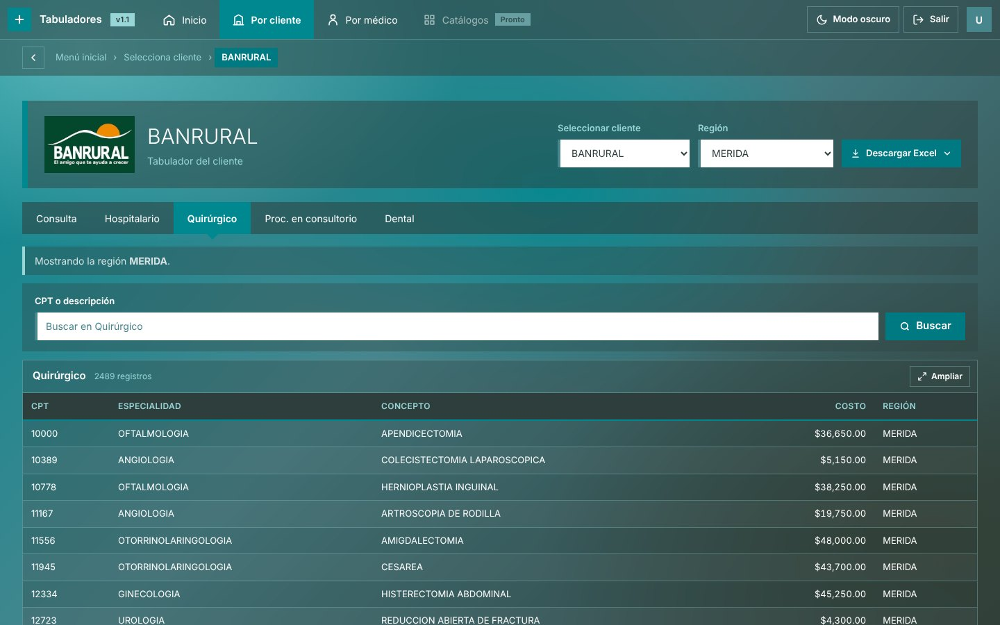

</div>

---

## 📌 El problema

Las áreas médicas de **INDEP, CNBV, BANRURAL** y otras instituciones manejan tabuladores con **decenas de miles de precios**: honorarios, procedimientos quirúrgicos, dentales y hospitalarios, cada uno con reglas distintas por cliente y por región. Consultarlos significaba abrir hojas de cálculo separadas, buscar a mano y comparar precios entre clientes y médicos.

## ✅ La solución

Una aplicación web que centraliza los tabuladores en **Supabase (PostgreSQL)** y permite:

- Consultar el tabulador de cada cliente, por región y tipo de servicio, en segundos.
- Buscar **por médico, especialidad, cliente o CPT** y ver de dónde viene cada precio: tabulador del cliente o tabulador especial.
- **Exportar a Excel** lo filtrado o el concentrado completo, listo para compartir.

> **35,000+ registros de tabulador · 3 clientes conectados · 11 regiones · 2 orígenes de precio · 0 servidores propios**

---

## ✨ Funciones principales

| | |
|---|---|
| 🏢 **Consulta por cliente** | Pestañas por tipo de servicio, configurables por cliente (CNBV usa las suyas). Región solo cuando aplica |
| 🗺️ **Reglas por región** | BANRURAL: Consulta y Hospitalario con precio único; Quirúrgico, Consultorio y Dental por región (11 regiones) |
| 👨‍⚕️ **Consulta por médico** | Un solo grid que une tabulador cliente y tabulador especial, con columna **Origen**. INDEP y JLFC tratados como una unidad |
| ⚡ **Búsqueda en vivo** | Resultados mientras se escribe, sin Enter, sin importar acentos ni mayúsculas. Se descartan respuestas viejas |
| 📊 **Grids propios** | Paginado de 10 en 10, vista ampliada, esqueleto de carga y formato moneda MXN |
| 📥 **Exportación a Excel** | Datos buscados o concentrado; por cliente o consolidado; con autofiltro y formato |
| 🌓 **Modo claro / oscuro** | Respeta la preferencia del sistema y la recuerda |
| 📱 **Responsive** | Se adapta a celulares y tabletas |
| 🧪 **Modo demo** | `?demo` genera datos ficticios con la misma estructura real, para mostrar el sistema sin exponer información |

---

## 🖼️ Capturas

| Acceso | Menú inicial |
|---|---|
| 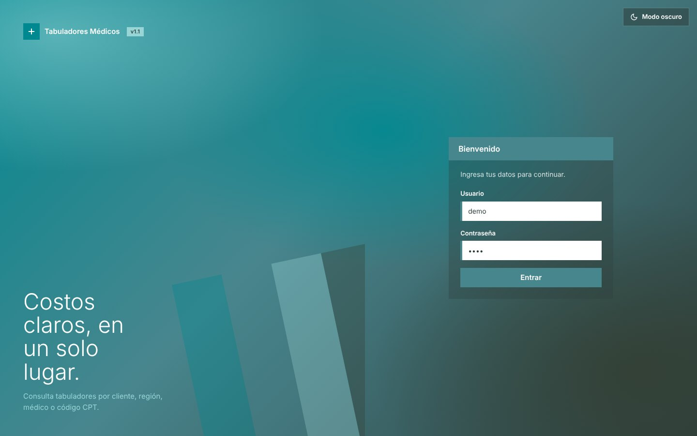 | 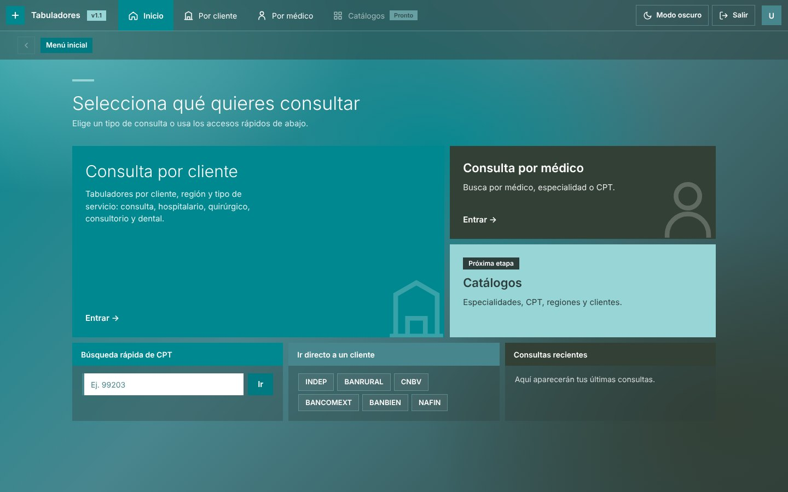 |
| **Selección de cliente** | **INDEP · Consulta (3 niveles de contacto)** |
| 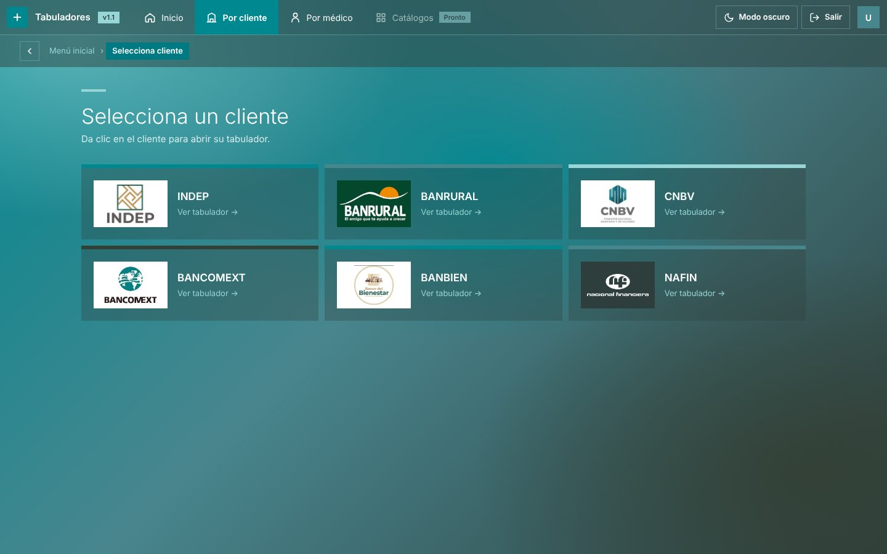 | 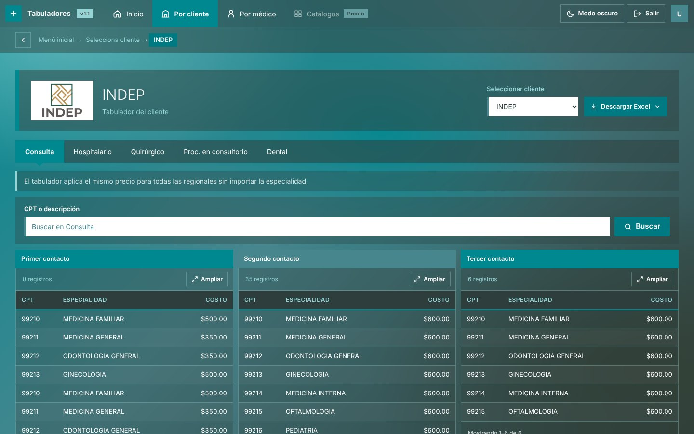 |
| **CNBV · Honorarios médicos (4 tablas)** | **Descargar a Excel** |
| 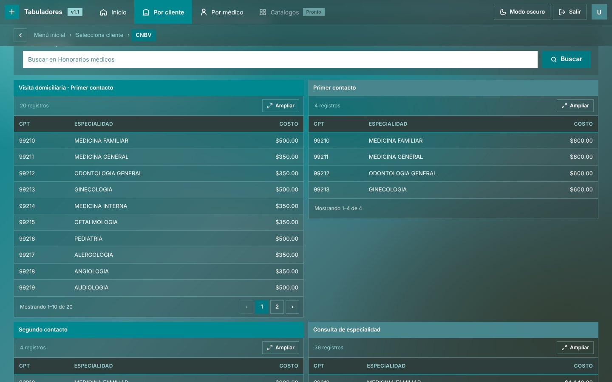 | 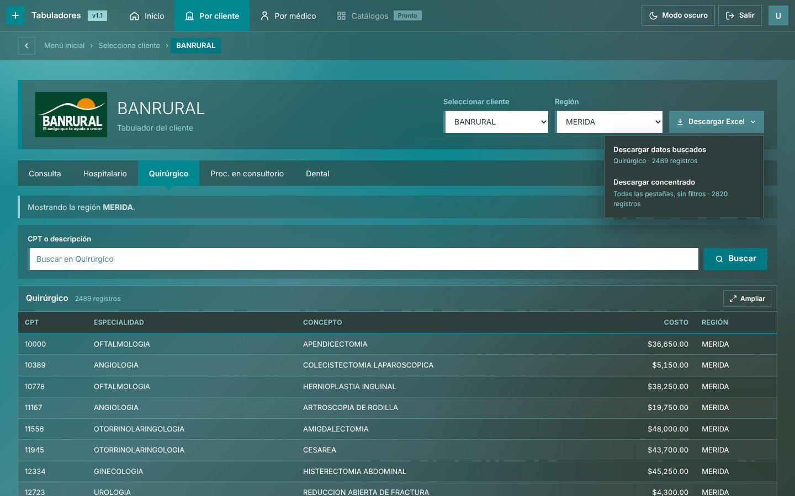 |
| **Consulta por médico** | **Grid ampliado con paginado** |
| 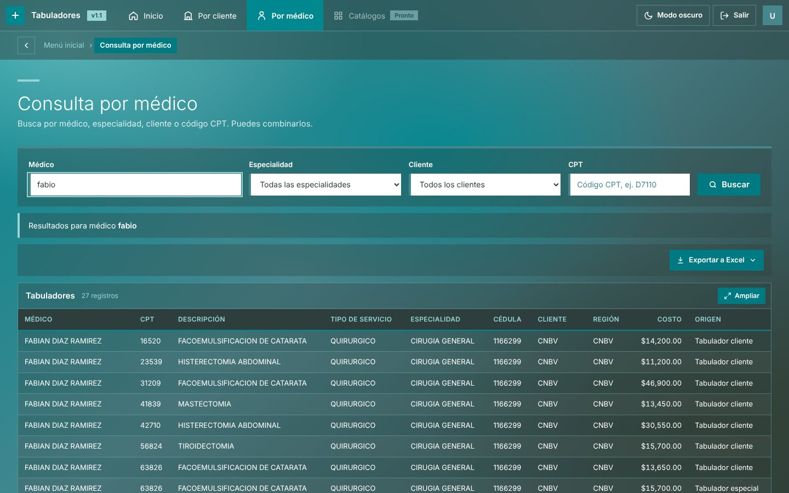 | 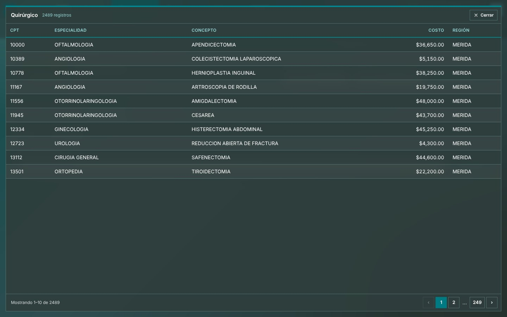 |
| **Modo oscuro** | **Móvil** |
| 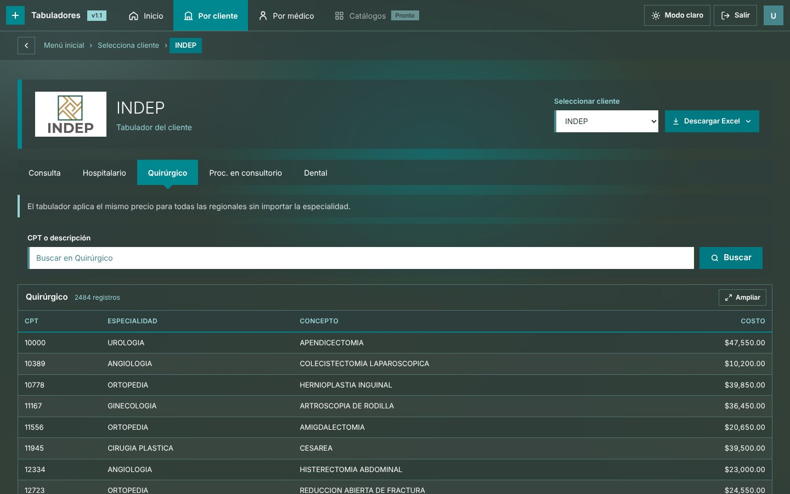 | 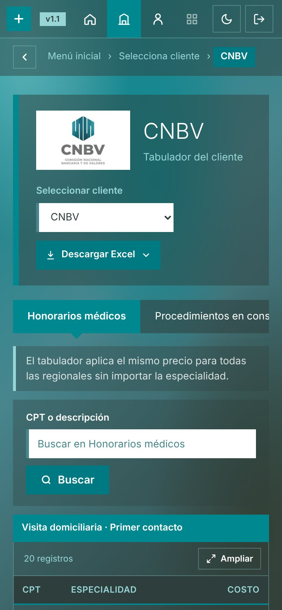 |

---

## 🛠️ Tecnologías

| Capa | Tecnología | Uso |
|---|---|---|
| Front-end | HTML5, CSS3, JavaScript (sin frameworks) | SPA en un solo archivo, navegación por hash, componentes propios |
| Base de datos | Supabase · PostgreSQL | Tablas, vistas `security_invoker` y Row Level Security |
| Conexión | `@supabase/supabase-js` 2.45 | API REST desde el navegador, con paginación por bloques |
| Excel | SheetJS 0.18 | Libros con varias hojas, autofiltro y formato moneda |
| Diseño | Variables CSS, glassmorphism, estilo Metro | Paleta institucional y tema claro/oscuro |

## 🏗️ Arquitectura

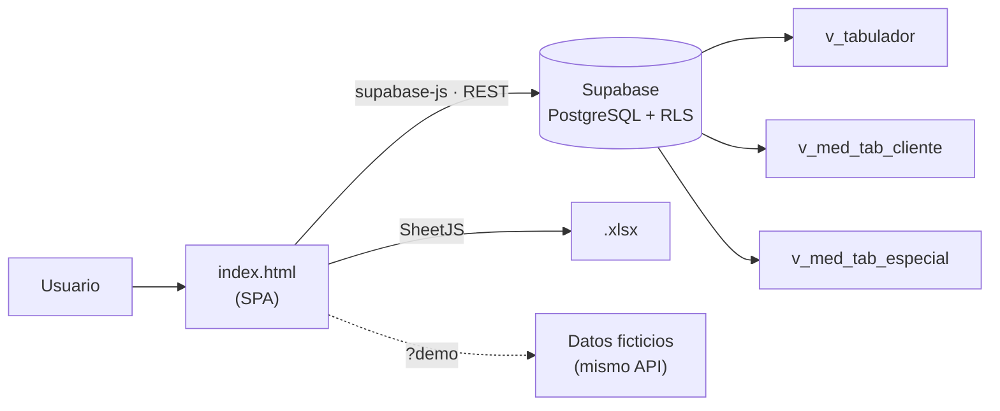

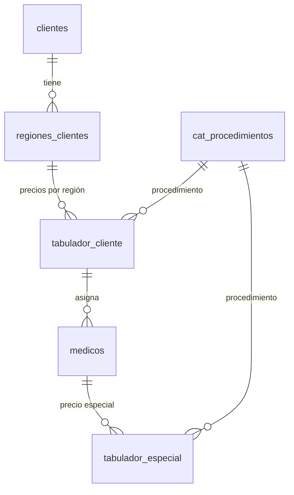

---

## 💡 Decisiones técnicas destacadas

- **Configuración por cliente (`CLIENT_CFG`)**: cada cliente se declara en un bloque, con sus pestañas, tablas, rangos y reglas de región. Agregar un cliente no requiere tocar el resto del código.
- **Vistas con `security_invoker`**: los joins viven en la base de datos, el front hace consultas simples, y las vistas respetan las políticas RLS de cada tabla.
- **Lectura por bloques de 1,000 filas**: evita el límite de PostgREST y permite cargar tablas de más de 2,400 registros por región.
- **Búsqueda en vivo con control de concurrencia**: espera de 400 ms al escribir y un contador de peticiones para que una respuesta lenta nunca pise a una más reciente.
- **Búsqueda insensible a acentos sin extensiones**: el patrón `ilike` convierte las vocales en comodín (`cardiologia` encuentra `CARDIOLOGÍA`).
- **Compatibilidad con visores embebidos**: un `fetch` propio serializa encabezados para evitar `DataCloneError` en vistas previas que reenvían peticiones por `postMessage`.
- **Modo demo con la misma API**: un cliente simulado imita a `supabase-js` (`from().select().eq().ilike().range()…`) y genera datos con los mismos rangos de la configuración real.

---

## 🚀 Cómo ejecutarlo

### Opción 1: demo (sin configurar nada)
Abre **https://erosamhi2026.github.io/tabuladores-medicos/?demo**, o descarga el repositorio y abre `index.html?demo` en Chrome o Edge.

### Opción 2: con tu propia base de datos en Supabase
1. En **Supabase → SQL Editor** corre los scripts de [`sql/`](sql/) en orden:
   - `01_vistas.sql`
   - `02_politicas_lectura_temporal.sql`
   - `04_ocultar_datos_sensibles.sql`
2. Al final de `index.html` configura `SUPABASE_URL` y `SUPABASE_KEY` (clave **publishable**; nunca la `service_role`).
3. Abre `index.html` en Chrome o Edge.

> 🔒 Mientras el login esté pendiente, las políticas de lectura son temporales. Ver [Seguridad (RLS)](docs/02_base_de_datos.md#25-seguridad-rls).

---

## 📁 Estructura

```
tabuladores-medicos/
├── index.html            Aplicación completa (HTML + CSS + JS)
├── sql/                  Vistas, políticas RLS y consultas de verificación
├── docs/                 Documentación técnica y de usuario
│   └── img/              Capturas
├── CHANGELOG.md          Historial de versiones
└── CLAUDE.md             Contexto técnico resumido
```

## 📚 Documentación

| Documento | Contenido |
|---|---|
| [Manual técnico](docs/01_manual_tecnico.md) | Arquitectura, funciones y cómo agregar un cliente |
| [Base de datos](docs/02_base_de_datos.md) | Diagrama ER, diccionario de datos, vistas y RLS |
| [Mapa de consultas](docs/03_mapa_de_consultas.md) | Qué consulta usa cada pantalla y grid |
| [Manual de usuario](docs/04_manual_de_usuario.md) | Uso paso a paso |
| [Pruebas](docs/05_pruebas.md) | 31 casos de prueba con resultado esperado |
| [Despliegue](docs/06_despliegue_y_mantenimiento.md) | Publicación, versiones y solución de problemas |

---

## 👤 Mi participación

Desarrollé el proyecto completo, **back-end y front-end**:

- **Base de datos**: análisis del modelo, consultas SQL por cliente y región, vistas, políticas RLS y protección de datos sensibles.
- **Front-end**: diseño de la interfaz a partir de las maquetas, componente de grid, navegación, búsqueda en vivo y exportación a Excel.
- **Integración**: conexión con Supabase, reglas de negocio (niveles de contacto, regiones de precio único, unidad INDEP-JLFC) y depuración en distintos entornos.
- **Entrega**: versionado semántico, documentación técnica y de usuario, y casos de prueba.

## 🗺️ Próximos pasos

- [ ] Login con Supabase Auth y permisos por rol
- [ ] Conectar BANCOMEXT, BANBIEN, NAFIN y JLFC
- [ ] Columna de clasificación en la BD para no depender de rangos de ids
- [ ] Módulo de Catálogos

---

<div align="center">

**Desarrollado por [Guillermo Navarrete](https://github.com/GuillermoNavarreteHer)** · [@GuillermoNavarreteHer](https://github.com/GuillermoNavarreteHer)

<sub>Los logotipos pertenecen a sus respectivas instituciones y se usan solo para identificar a cada cliente dentro del sistema. Los datos de la demo son ficticios.</sub>

</div>
