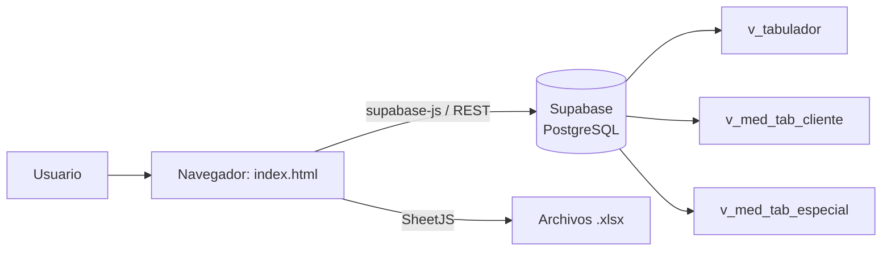
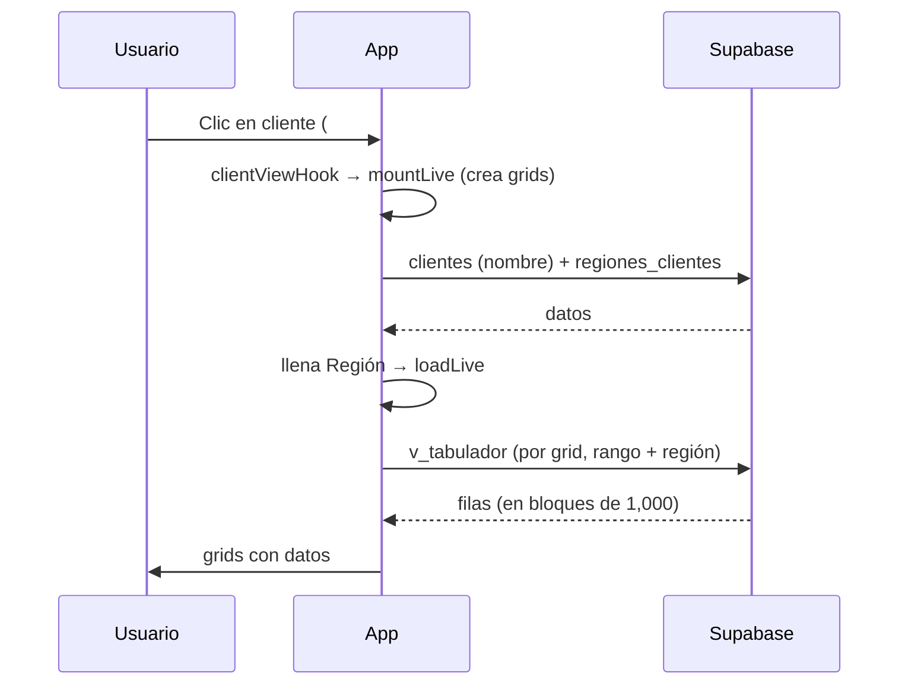

# 1. Manual técnico

## 1.1 Resumen
Aplicación web de una sola página (SPA) en **un solo archivo** (`index.html`). Lee los tabuladores médicos desde **Supabase** (PostgreSQL + API REST) y los muestra en tablas paginadas con filtros y exportación a Excel.

| Elemento | Tecnología |
|---|---|
| Interfaz | HTML5 + CSS3, sin frameworks |
| Lógica | JavaScript, sin compilación |
| Base de datos | Supabase (PostgreSQL) con RLS |
| Conexión | `@supabase/supabase-js` 2.45.4, por CDN jsDelivr |
| Excel | SheetJS (`xlsx`) 0.18.5, por CDN cdnjs |
| Tipografía | Segoe UI / Open Sans (Google Fonts) |

No hay servidor propio: el navegador se conecta directo a Supabase con la **clave publishable**.

## 1.2 Arquitectura



## 1.3 Estructura de `index.html`

| Bloque | Contenido |
|---|---|
| `<head>` | Encabezado de versión, metadatos y fuentes |
| `<style>` | Paleta (variables CSS), modo claro/oscuro, estilo Metro (paneles translúcidos), grids, esqueleto de carga, menús |
| `#login` | Pantalla de acceso (maqueta, no valida) |
| `#app` → `header.topnav` | Menú superior: Inicio, Por cliente, Por médico, Catálogos |
| `.pathbar` | Barra de ubicación tipo explorador |
| `#v-menu` | Menú inicial |
| `#v-clientes` | Tarjetas de clientes con logotipo |
| `#v-cliente` | Apartado del cliente: seleccionar cliente, región, descargar, pestañas, filtros, grids |
| `#v-medico` | Consulta por médico: filtros, exportar y grid |
| `<script>` principal | Toda la lógica (ver 1.4) |
| `<script>` final | SheetJS, supabase-js y la conexión (`SUPABASE_URL`, `SUPABASE_KEY`, `db`) |

### Paleta (variables CSS)
`--blanco #ffffff` · `--pino #2e3e3c` · `--teal #008890` · `--aqua #97d5d7` · `--petroleo #48868e` · `--bosque #334035` · `--teal-oscuro #007a82` (solo fondo de botones pequeños con texto blanco).

## 1.4 Módulos del JavaScript

### Navegación
| Nombre | Qué hace |
|---|---|
| `CLIENTS`, `byId`, `LOGOS` | Lista de clientes con su nombre y logotipo (base64) |
| `render()` | Muestra la vista según `location.hash` (`#login`, `#menu`, `#clientes`, `#medico`, `#indep`, …) |
| `go(ruta)` | Cambia de vista |
| `crumbsFor(ruta)` | Arma la barra de ubicación |
| `setLogged()` | Sesión de maqueta (sessionStorage) |
| `currentTheme()`, `paintToggles()` | Modo claro / oscuro (localStorage) |

### Componente de grid
`createGrid(contenedor, { title, columns })` crea una tabla con paginado de 10 en 10, botón **Ampliar** y esqueleto de carga. Devuelve:

| Método | Uso |
|---|---|
| `setState(estado, texto)` | `loading` · `ready` · `error` · `info` · `noregion` · `pending` |
| `setRows(filas)` | Carga los datos y deja el estado en `ready` |
| `setFilter(texto)` | Filtro de texto (columnas no monetarias) |
| `setPredicate(fn)` | Filtro por función |
| `getRows()` | Filas visibles, con filtros |
| `getAllRows()` | Todas las filas, sin filtros |
| `isReady()`, `getState()` | Estado actual |

Columnas: `{ key, label, type: 'money' }`. El tipo `money` formatea en pesos MXN.

### Por cliente
| Nombre | Qué hace |
|---|---|
| `CLIENT_CFG` | **Configuración central**: por cliente, `id_cliente` y, por pestaña, los grids con su consulta |
| `spec(select, rangos, especialidad)` | Arma una consulta sobre `v_tabulador` por rangos de `id_tabulador_cliente` y/o especialidad |
| `fetchTabulador()` | Lee en bloques de 1,000 filas (límite de Supabase) |
| `conRegion(load)` | Agrega la columna Región a las filas |
| `mountLive(cliente)` | Crea los grids del cliente en cada pestaña |
| `initLive(cliente)` | Lee el nombre y las regiones, y luego llama a `loadLive` |
| `loadLive(soloRegion)` | Ejecuta las consultas de todos los grids. `regionFija` ignora la región elegida |
| `REGION_BLOQUEADA` | Clientes de región única: sin desplegable (`indep`, `jlfc`, `cnbv`) |
| `TAB_LABELS` | Nombres de pestañas por cliente (CNBV) |
| `updateRegionNote()` | Aviso de región y ocultar el desplegable en pestañas de precio único |
| `descargarCliente(modo)` | Excel: `buscados` (pestaña actual filtrada) o `concentrado` (todo) |
| `clientViewHook(ruta)` | Coordina todo lo anterior al entrar o salir de un cliente |

### Por médico
| Nombre | Qué hace |
|---|---|
| `buscarMed()` | Consulta `v_med_tab_cliente` y `v_med_tab_especial`, une los resultados y agrega `origen` |
| `EXCLUIR_CLIENTES` | `['JLFC']`: JLFC e INDEP son la misma unidad |
| `flexible(texto)` | Patrón `ilike` insensible a acentos (las vocales son comodín) |
| `medAuto()` | Búsqueda en vivo (espera de 400 ms; médico desde 2 letras) |
| `medReq` | Descarta respuestas viejas si se escribe rápido |
| `comboModo`, `llenarCatalogo()`, `syncCombos()` | Combos Especialidad / Cliente: catálogo completo o valores del médico |
| `MS` | Estado interno de los filtros de los combos (sin interfaz propia) |
| `exportar(modo)` | Excel: `concentrado` o por `cliente` |

### Modo demo
`?demo` en la dirección activa `DEMO`. `crearClienteDemo()` genera datos ficticios a partir de `CLIENT_CFG` (rangos en `load.meta`, regiones, `regionFija`, `ocultarRegiones`) y médicos de ejemplo, y devuelve un objeto con la misma API que `supabase-js`. Se usa para la demo pública y las capturas.

### Conexión
Sin `?demo`: `db = supabase.createClient(SUPABASE_URL, SUPABASE_KEY, { global: { fetch: fetchCompatible } })`. `fetchCompatible` evita el error `DataCloneError` en visores que reenvían peticiones.

## 1.5 Flujo al entrar a un cliente



## 1.6 Cómo agregar un cliente
1. Verifica en Supabase su `id_cliente`, sus regiones y los rangos de `id_tabulador_cliente` (ver `sql/03_consultas_verificacion.sql`).
2. Agrega su bloque en `CLIENT_CFG`:
   ```js
   nafin: { id_cliente: 5, panels: {
     consulta:     [{ head: 'Primer contacto', title: 'Consulta · Primer contacto', columns: COLS_CONTACTO, load: spec(SEL_CONTACTO, [[100, 120]]) }],
     hospitalario: [{ title: 'Hospitalario', columns: COLS_HOSP, load: spec('cpt, concepto, costo', [[121, 130]]) }],
     // quirurgico, consultorio, dental …
   } },
   ```
3. Si las pestañas se llaman distinto, agrégalas en `TAB_LABELS`.
4. Si tiene una sola región, agrégalo en `REGION_BLOQUEADA`. Si un grid usa siempre la misma región, ponle `regionFija: <id>`. Si una región no debe aparecer en el desplegable, usa `ocultarRegiones: [<id>]`.
5. Prueba los conteos (ver [Pruebas](05_pruebas.md)) y sube la versión (ver [Despliegue](06_despliegue_y_mantenimiento.md)).

## 1.7 Convenciones
- Interfaz y comentarios en **español**.
- Colores siempre con `var(--…)`.
- Búsquedas **en vivo**, sin Enter.
- Cambios solo en lo que se pide. Cada entrega sube versión y actualiza `CHANGELOG.md`.

## 1.8 Deuda técnica conocida
- Hay código que ya no se usa y conviene limpiar en una versión futura:
  - `INDEP_ID` y `consultas()`: reemplazados por `CLIENT_CFG`.
  - `BANRURAL_REGIONES` y `loadRegionesBanrural()`: reemplazados por `initLive`.
  - La interfaz de `createMulti`: los filtros tipo Excel están ocultos y solo se usa su estado `MS`.
- Los rangos por `id_tabulador_cliente` dependen de los ids actuales. Una columna de clasificación en la BD (p. ej. `grupo`) los haría más robustos.
- El login es de maqueta y los permisos son temporales (ver [Base de datos](02_base_de_datos.md#25-seguridad-rls)).
