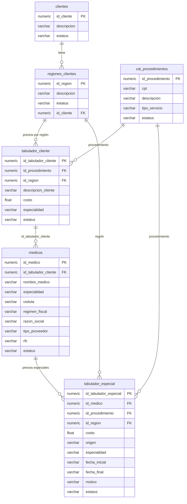

# 2. Base de datos

Supabase (PostgreSQL), esquema `public`. **RLS activado en todas las tablas.**

## 2.1 Diagrama entidad-relación

> Las relaciones se dedujeron de las consultas del proyecto. Para confirmar qué llaves foráneas existen realmente en Supabase, consulta `information_schema.table_constraints`.

## 2.2 Diccionario de datos

### clientes
| Columna | Tipo | Descripción |
|---|---|---|
| id_cliente | numeric | Identificador. 1 = BANRURAL, 2 = INDEP, 4 = CNBV |
| descripcion | varchar | Nombre del cliente (en MAYÚSCULAS) |
| estatus | varchar | Estado del registro |

### regiones_clientes
| Columna | Tipo | Descripción |
|---|---|---|
| id_region | numeric | Identificador de región |
| descripcion | varchar | Nombre (p. ej. MÉRIDA) |
| estatus | varchar | Estado |
| id_cliente | numeric | Cliente al que pertenece |

### cat_procedimientos
| Columna | Tipo | Descripción |
|---|---|---|
| id_procedimiento | numeric | Identificador |
| cpt | varchar | Código CPT (p. ej. 99203, D7110) |
| descripcion | varchar | Descripción del procedimiento |
| tipo_servicio | varchar | Tipo de servicio |
| estatus | varchar | Estado |

### tabulador_cliente
| Columna | Tipo | Descripción |
|---|---|---|
| id_tabulador_cliente | numeric | Identificador. **Sus rangos definen cada grid** (ver [Mapa de consultas](03_mapa_de_consultas.md)) |
| id_procedimiento | numeric | Procedimiento (CPT) |
| id_region | numeric | Región del cliente |
| descripcion_cliente | varchar | Concepto tal como lo nombra el cliente |
| costo | double | Precio |
| especialidad | varchar | Especialidad (p. ej. CONSULTAS, HOSPITALIZACION) |
| estatus | varchar | Estado |

### medicos
| Columna | Tipo | Descripción |
|---|---|---|
| id_medico | numeric | Identificador |
| id_tabulador_cliente | numeric | Registro del tabulador del cliente que le aplica |
| nombre_medico | varchar | Nombre completo |
| especialidad | varchar | Especialidad |
| cedula | varchar | Cédula profesional |
| regimen_fiscal, razon_social, tipo_proveedor, rfc | varchar | **Datos fiscales (sensibles)**. La app no los usa |
| estatus | varchar | Estado |

### tabulador_especial
| Columna | Tipo | Descripción |
|---|---|---|
| id_tabulador_especial | numeric | Identificador |
| id_medico | numeric | Médico |
| id_procedimiento | numeric | Procedimiento |
| id_region | numeric | Región |
| costo | double | Precio especial |
| origen | varchar | Origen del precio |
| especialidad | varchar | Especialidad |
| fecha_inicial, fecha_final | varchar | Vigencia (guardadas como texto) |
| motivo | varchar | Motivo (p. ej. autorización) |
| estatus | varchar | Estado |

## 2.3 Vistas (`sql/01_vistas.sql`)
Todas se crean `with (security_invoker = true)`, así respetan el RLS de las tablas.

| Vista | Une | Columnas | La usa |
|---|---|---|---|
| `v_tabulador` | tabulador_cliente + cat_procedimientos | id_tabulador_cliente, id_region, cpt, especialidad, concepto, costo | Por cliente |
| `v_med_tab_cliente` | medicos + tabulador_cliente + cat_procedimientos + regiones_clientes + clientes | id_medico, nombre_medico, cpt, descripcion, tipo_servicio, especialidad, cedula, costo, cliente, region | Por médico (origen: Tabulador cliente) |
| `v_med_tab_especial` | medicos + tabulador_especial + cat_procedimientos + regiones_clientes + clientes | las mismas + motivo | Por médico (origen: Tabulador especial) |

## 2.4 Datos de referencia
| Cliente | id_cliente | Regiones |
|---|---|---|
| BANRURAL | 1 | 1–11 (MAZATLÁN … PUEBLA) + 19 "BANRURAL", que guarda Consulta y Hospitalario y está oculta en la app |
| INDEP | 2 | 12 |
| CNBV | 4 | 14 |
| JLFC | — | Misma unidad que INDEP; se excluye en Por médico |

## 2.5 Seguridad (RLS)
| Política | Rol | Estado |
|---|---|---|
| "Prueba temporal lectura …" (6 tablas) | `anon` | **Activa (temporal)**: cualquiera con la URL y la clave puede leer |
| "Lectura con sesion" (6 tablas) | `authenticated` | Preparada en `sql/02_…`, se activará con el login |
| Columnas fiscales de `medicos` | `anon` | Bloqueadas con `sql/04_ocultar_datos_sensibles.sql` (recomendado) |

> La clave **publishable** es pública por diseño. La seguridad depende de RLS. La clave `service_role` nunca debe ir en el front ni en el repositorio.
